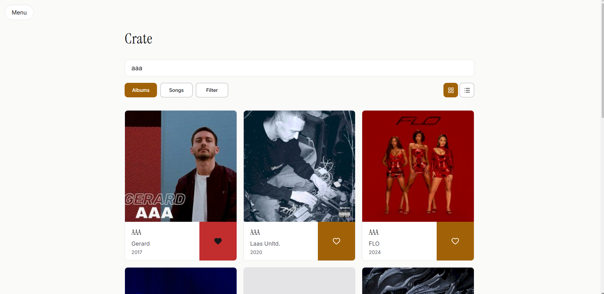
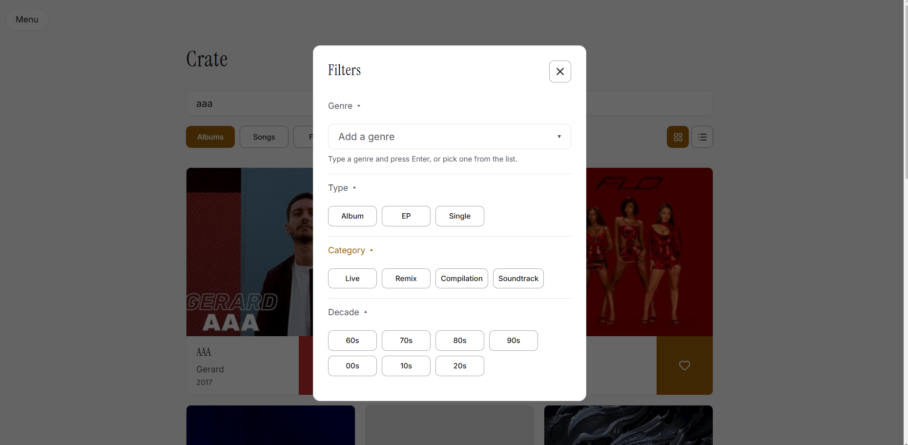

# Crate

Crate is a web app for discovering music and keeping track of what you like. You can search albums and songs, filter them by genre, type, decade and more, save albums to your own collection and build playlists. All the music data comes from the public [MusicBrainz](https://musicbrainz.org/) API.

**Live:** https://musiccrate-adil.netlify.app




## What it does

- **Search** albums or songs by name or artist, in a grid or a list
- **Filters**: genre (the full MusicBrainz list of ~2000 genres, searchable), type (album, EP, single), category (live, remix, compilation, soundtrack), duration and decade
- **Album page** with cover, tracklist, track durations and total length
- **Collection**: save albums with one click, sort them by date saved, title or artist
- **Playlists**: create, rename and delete them, add songs from anywhere in the app, see the song count and total duration
- **Light and dark theme**, following the system setting until you pick one yourself
- Everything is kept in the browser (localStorage), so it's still there after a refresh

## Tech

- React 19 + TypeScript
- Vite
- React Router
- Tailwind CSS v4 (all colors and fonts as design tokens in `@theme`)
- Lucide for icons
- Vitest + React Testing Library for tests
- Deployed on Netlify

No state management library: two React contexts (collection and playlists) were enough for this size.

## Things I paid attention to

**The search lives in the URL.** The search text, albums/songs mode, grid/list view and every filter are stored in the address, not in component state. A refresh keeps everything, you can send a link to someone and they see the same results, and the Back button works the way you'd expect. Typing uses `replace` so every letter doesn't become a step in the history.

**Respecting the MusicBrainz rate limit.** MusicBrainz allows about one request per second. Every request goes through one function that waits for its turn in a small queue, checks the response and throws a clear error if something went wrong. On top of that, the search waits 500 ms after you stop typing before it sends anything.

**Building the search query separately from the UI.** All filters are turned into a MusicBrainz (Lucene) query by one pure function, `buildQuery`, which has no idea about React. The rules: options that can't be true at the same time are combined with OR (an album is either an EP or a single), filters that can be combined use AND (rock *and* from the 90s). Values coming from the URL are validated, so a hand-edited link can't break the query. This function has the most tests in the project, because a missing bracket here gives wrong results without any error.

**Accessibility.** Lighthouse gives 100, but most of the work is the part it can't check:
- modals are real dialogs: focus moves inside when they open, Tab can't leave them, Escape and the close button close them, and focus goes back to the button that opened them
- toggle buttons announce whether they're on (`aria-pressed`), the theme switch is a real `role="switch"`
- every icon-only button has a name that says what it does and to what ("Save OK Computer")
- choosing playlists for a song uses real checkboxes, so it works with the keyboard and screen readers out of the box
- the modal, list and filter animations respect "reduce motion"
- both themes were checked for contrast

**No theme flash.** A small script in `index.html` sets the theme before the first paint, so the page doesn't flash dark before switching to light. The app only saves the theme when you actually choose one, so until then it keeps following your system.

**Clear actions.** Each action has its own icon and only one meaning: a heart saves an album, a list icon adds a song to a playlist. Before, a "+" meant three different things depending on where you were.

## Tests

```bash
npm test          # watch mode
npm run build     # runs all tests first, then type checks and builds
```

Tests cover the formatting helpers, the whole query builder, the reusable filter options, the modal (dialog role, Escape, close button, focus moving in, focus trap, focus returning) and the full flow of creating a playlist, including that it survives a reload. Tests look for elements by role and name, the same way a screen reader would, so they also catch accessibility regressions.

The build on Netlify runs the tests first, so a failing test stops the deploy and the live site stays on the last working version.

## Running it locally

```bash
git clone https://github.com/Annubiss/music-crate.git
cd music-crate
npm install
npm run dev
```

## Project structure

```
src/
  api/musicbrainz.ts   requests, rate-limit queue, mapping API data to my types
  lib/                 pure helpers: query builder, formatting, localStorage
  context/             collection and playlists
  components/          reusable UI (Button, Modal, FilterSection, OptionGroup, cards...)
  pages/               one file per route
  test/setup.ts        test setup
```

## What I'd improve next

- Announce search results to screen readers (how many were found, loading, errors)
- Move focus properly when the side menu opens and closes
- One link per album card instead of two (cover and title)
- Keyboard arrows in the genre list
- Make the remaining animations (loading skeletons, side menu) respect "reduce motion" too
- A small backend so collections and playlists sync across devices and playlists can be shared

## Credits

Music data from [MusicBrainz](https://musicbrainz.org/), cover art from the [Cover Art Archive](https://coverartarchive.org/), icons from [Lucide](https://lucide.dev/).
